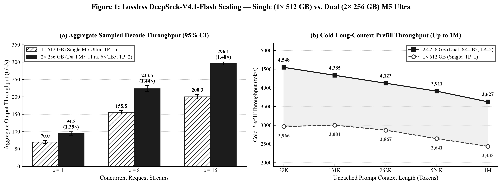
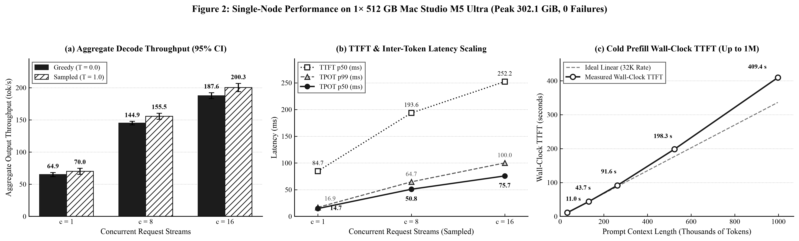
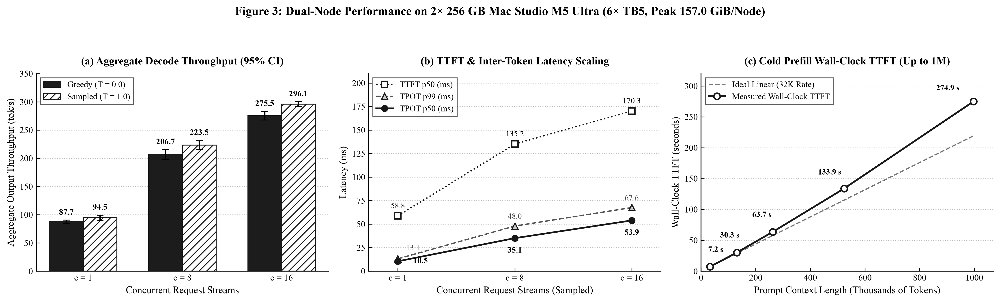
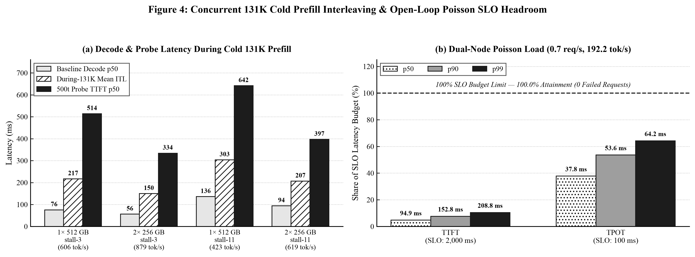

# Machd

[](https://ko-fi.com/machddev)

High-throughput **strictly lossless** inference server for **DeepSeek-V4.1-Flash** (text, structured outputs, and native vision) on Apple Silicon — supporting both **Single-Node (`1× 512 GB`)** and **Dual-Node (`2× 256 GB` over Thunderbolt 5)** Mac Studio M5 Ultra deployments via OpenAI (`/v1/chat/completions`, `/v1/responses`) and Anthropic (`/v1/messages`) compatible streaming APIs.

---

## Why Lossless Matters — Checkpoint-Exact Execution

Many local and Apple Silicon inference engines report headline token/s numbers without clearly declaring that the underlying model has been **lossily altered** — commonly re-quantizing `BF16` embeddings and the `129,280 × 5,120` output head down to 4-bit or 6-bit, compressing `FP8` attention and shared-expert projections into `FP4`, truncating or re-quantizing the `188.8 GiB` N-gram memory tables, or accepting approximate draft tokens (`KL > 0`). On frontier MoE coding, math, and long-context reasoning models, undeclared precision loss silently degrades multi-file code generation, tool-call reliability, structured schema adherence, and deep-context retrieval even when casual chat appears fluent.

**Machd is 100% lossless relative to the official [`deepseek-ai/DeepSeek-V4.1-Flash-1017`](https://huggingface.co/deepseek-ai/DeepSeek-V4.1-Flash-1017) release (`511.26 GiB` logical footprint).** Every parameter tensor is loaded directly from the official DeepSeek checkpoint and executed at its exact native published precision — with zero post-training re-quantization, zero layer or expert pruning, zero N-gram table truncation, and exact target-verified decoding (`KL = 0.0`):

| Model Component (`deepseek-ai/DeepSeek-V4.1-Flash-1017`) | Official Checkpoint Precision | Machd Execution Precision | Verification |
| :--- | :--- | :--- | :--- |
| Token Embeddings & Output Head (`129,280 × 5,120`) | `BF16` | **`BF16` (Unquantized)** | Bit-exact IEEE-754 `BF16` |
| Vision Encoder (`ViT` + Aligner) | `BF16` (`0.97 GiB`) | **`BF16` (Unquantized)** | Byte-for-byte native weights |
| Hyper-Connections (`mHC4`) & Router Biases / Sinks | `FP32` | **`FP32` (Full 20-iter Sinkhorn)** | Exact reference precision |
| RMSNorms (`attn`, `ffn`, `q_norm`, `kv_norm`) & Router Gates | `BF16` | **`BF16` (`FP32` reduction)** | Bit-exact weights |
| MLA Projections (`wq_a`, `wkv`, `wq_b`, `wo_a`, `wo_b`) & Shared Experts | `F8_E4M3` + `[32, 32]` `UE8M0` | **Native `F8_E4M3` + `UE8M0`** | Zero post-training re-quantization |
| Routed MoE Experts (`384` Backbone / `128` MTP per Layer) | OCP `MXFP4` + `[1, 32]` `UE8M0` | **Native OCP `MXFP4` + `UE8M0`** | All `384` / `128` experts intact |
| Engram N-Gram Memory Tables (`768M` Rows, `188.83 GiB`) | `F8_E4M3` + `[1, 32]` `UE8M0` | **Native `F8_E4M3` + `UE8M0`** | Zero-copy in-place, `0` rows dropped |
| Multi-Token Speculative Decoding (`3` Native MTP Layers) | Exact Target Distribution | **Exact Rejection Sampling** | `KL = 0.0` (mathematically lossless) |



---

## Single-Node Benchmarks (`1× 512 GB` Mac Studio M5 Ultra)

*Recorded on a single `512 GB` Apple Mac Studio M5 Ultra (`TP=1`) with native `BF16` vision loaded, zero multi-node links, and `0` failed requests across all `459` benchmark requests up to `1,000,000` context tokens.*



### 1. Interactive Concurrency & Latency (`c1`–`c16`, `poisson`)

*Closed-loop runs: `15 s` warmup + `90 s` across `6` measurement windows (`max_tokens=256`, `thinking=false`). Open-loop `poisson`: `0.7 req/s` arrival rate.*

| Workload (`1× 512 GB`) | Output Throughput | 95% CI | TTFT p50 | TTFT p90 | TTFT p99 | TPOT p50 | TPOT p90 | TPOT p99 | Failed |
| :--- | ---: | ---: | ---: | ---: | ---: | ---: | ---: | ---: | ---: |
| `c1` (greedy, `T=0.0`) | **64.9 tok/s** | ±5.1% | 87.3 ms | 91.8 ms | 99.9 ms | 15.4 ms | 16.3 ms | 18.2 ms | 0 |
| `c1-sampled` (`T=1.0`) | **70.0 tok/s** | ±6.8% | 84.7 ms | 88.2 ms | 90.9 ms | 14.7 ms | 16.7 ms | 16.9 ms | 0 |
| `c8` (greedy, `T=0.0`) | **144.9 tok/s** | ±1.9% | 196.7 ms | 214.5 ms | 230.3 ms | 53.7 ms | 66.4 ms | 70.8 ms | 0 |
| `c8-sampled` (`T=1.0`) | **155.5 tok/s** | ±3.1% | 193.6 ms | 215.5 ms | 288.2 ms | 50.8 ms | 62.2 ms | 64.7 ms | 0 |
| `c16` (greedy, `T=0.0`) | **187.6 tok/s** | ±2.4% | 254.1 ms | 335.5 ms | 352.6 ms | 81.3 ms | 101.9 ms | 112.2 ms | 0 |
| `c16-sampled` (`T=1.0`) | **200.3 tok/s** | ±3.2% | 252.2 ms | 322.5 ms | 345.5 ms | 75.7 ms | 94.8 ms | 100.0 ms | 0 |
| `poisson` (`0.7 req/s`) | **170.3 tok/s** | ±3.1% | 212.8 ms | 316.6 ms | 456.2 ms | 115.7 ms | 137.9 ms | 156.4 ms | 0 |

### 2. Cold Long-Context Prefill (`32K` → `1,000,000` Tokens)

| Target Context | Actual Prompt Tokens | Cold Prefill Throughput | Wall-Clock TTFT | Failed |
| :--- | ---: | ---: | ---: | ---: |
| 32K | 32,734 | **2,965.6 tok/s** | **11.04 s** | 0 |
| 131K | 131,200 | **3,001.0 tok/s** | **43.72 s** | 0 |
| 262K | 262,515 | **2,866.8 tok/s** | 91.57 s | 0 |
| 524K | 523,672 | **2,641.2 tok/s** | 198.27 s | 0 |
| **1,000,000 (1M)** | 997,142 | **2,435.3 tok/s** | **409.45 s** | 0 |

### 3. Mixed Long-Prefill Interleaving (`stall-3` & `stall-11`)

*`131,213`-token cold prefill injected concurrently with `3` or `11` active decode streams plus five `500`-token interactive probes.*

| Workload (`1× 512 GB`) | 500t Probe TTFT p50 | 500t Probe TTFT Max | Decode Mean (During) | Decode p90 (During) | Decode p99 (During) | Baseline Decode p50 | Concurrent 131K Prefill | Failed |
| :--- | ---: | ---: | ---: | ---: | ---: | ---: | ---: | ---: |
| `stall-3` (131K + 3 streams) | **0.514 s** | **0.661 s** | 217.0 ms | 224.9 ms | 276.4 ms | 75.7 ms | **606.3 tok/s** | 0 |
| `stall-11` (131K + 11 streams) | **0.642 s** | **0.672 s** | 303.4 ms | 318.5 ms | 336.0 ms | 136.0 ms | **422.5 tok/s** | 0 |

### 4. Single-Node Memory & Reliability Summary (`1× 512 GB`)

| Metric | Value |
| :--- | :--- |
| Active GPU Memory (with native vision loaded) | **293.88 GiB** |
| Peak GPU Memory (across full suite up to `1M` context) | **302.07 GiB / 512 GiB** |
| Total Benchmark Requests / Failures | **459 / 0** |

---

## Dual-Node Benchmarks (`2× 256 GB` Mac Studio M5 Ultra)

*Recorded on `2× 256 GB` Apple Mac Studio M5 Ultra (`TP=2`) connected over 6-cable Thunderbolt 5 with native `BF16` vision loaded (`0` failed requests across all `613` benchmark requests and `100.0%` Poisson SLO attainment).*



### 1. Interactive Concurrency & Latency (`c1`–`c16`, `poisson`)

*Closed-loop runs: `15 s` warmup + `90 s` across `6` measurement windows (`max_tokens=256`, `thinking=false`). Open-loop `poisson`: `0.7 req/s` arrival rate with `TTFT <= 2.0 s` and `TPOT <= 100 ms` SLO targets (**`100.0%` attainment**).*

| Workload (`2× 256 GB`) | Output Throughput | 95% CI | TTFT p50 | TTFT p90 | TTFT p99 | TPOT p50 | TPOT p90 | TPOT p99 | Failed |
| :--- | ---: | ---: | ---: | ---: | ---: | ---: | ---: | ---: | ---: |
| `c1` (greedy, `T=0.0`) | **87.7 tok/s** | ±3.2% | 60.3 ms | 61.5 ms | 62.8 ms | 11.3 ms | 12.7 ms | 13.3 ms | 0 |
| `c1-sampled` (`T=1.0`) | **94.5 tok/s** | ±5.3% | 58.8 ms | 60.8 ms | 62.3 ms | 10.5 ms | 12.3 ms | 13.1 ms | 0 |
| `c8` (greedy, `T=0.0`) | **206.7 tok/s** | ±4.3% | 139.3 ms | 199.0 ms | 324.9 ms | 37.8 ms | 46.7 ms | 50.5 ms | 0 |
| `c8-sampled` (`T=1.0`) | **223.5 tok/s** | ±3.8% | 135.2 ms | 142.7 ms | 231.4 ms | 35.1 ms | 43.4 ms | 48.0 ms | 0 |
| `c16` (greedy, `T=0.0`) | **275.5 tok/s** | ±2.8% | 173.7 ms | 231.9 ms | 355.1 ms | 57.1 ms | 69.3 ms | 78.7 ms | 0 |
| `c16-sampled` (`T=1.0`) | **296.1 tok/s** | ±1.5% | 170.3 ms | 219.2 ms | 295.0 ms | 53.9 ms | 63.4 ms | 67.6 ms | 0 |
| `poisson` (`0.7 req/s`) | **192.2 tok/s** | ±14.3% | **94.9 ms** | **152.8 ms** | **208.8 ms** | **37.8 ms** | **53.6 ms** | **64.2 ms** | 0 |

### 2. Cold Long-Context Prefill (`32K` → `1,000,000` Tokens)

| Target Context | Actual Prompt Tokens | Cold Prefill Throughput | Wall-Clock TTFT | Speedup vs. `1× 512 GB` | Failed |
| :--- | ---: | ---: | ---: | ---: | ---: |
| 32K | 32,734 | **4,547.6 tok/s** | **7.20 s** | **1.53×** | 0 |
| 131K | 131,200 | **4,334.9 tok/s** | **30.27 s** | **1.44×** | 0 |
| 262K | 262,515 | **4,123.2 tok/s** | 63.67 s | **1.44×** | 0 |
| 524K | 523,672 | **3,910.6 tok/s** | 133.91 s | **1.48×** | 0 |
| **1,000,000 (1M)** | 997,142 | **3,627.1 tok/s** | **274.92 s** | **1.49×** | 0 |

### 3. Mixed Long-Prefill Interleaving & Open-Loop SLO Headroom



| Workload (`2× 256 GB`) | 500t Probe TTFT p50 | 500t Probe TTFT Max | Decode Mean (During) | Decode p90 (During) | Decode p99 (During) | Baseline Decode p50 | Concurrent 131K Prefill | Failed |
| :--- | ---: | ---: | ---: | ---: | ---: | ---: | ---: | ---: |
| `stall-3` (131K + 3 streams) | **0.334 s** | **0.392 s** | **149.8 ms** | **155.4 ms** | **239.4 ms** | 56.1 ms | **878.8 tok/s** | 0 |
| `stall-11` (131K + 11 streams) | **0.397 s** | **0.443 s** | **206.7 ms** | **208.2 ms** | 388.1 ms | 94.0 ms | **618.7 tok/s** | 0 |

### 4. Dual-Node Memory & Reliability Summary (`2× 256 GB`)

| Metric | Value |
| :--- | :--- |
| Active GPU Memory (per node, with native vision loaded) | **151.95 GiB** |
| Peak GPU Memory (per node, up to `1M` context) | **156.99 GiB / 256 GiB** |
| Open-Loop Poisson SLO Attainment (`TTFT <= 2.0 s`, `TPOT <= 100 ms`) | **100.0% (`0.74 req/s` goodput)** |
| Total Benchmark Requests / Failures | **613 / 0** |
| Interconnect Health | **6/6 Thunderbolt 5 links active, 0 errors** |

---

## Quickstart

Machd ships pre-compiled for Apple Silicon (`arm64`, macOS 15+) — **no C++ or Metal compilation required**. Everything runs through the single `./machd` CLI using the **official [`deepseek-ai/DeepSeek-V4.1-Flash-1017`](https://huggingface.co/deepseek-ai/DeepSeek-V4.1-Flash-1017)** weights.

### Option A — Single Mac (`1× 512 GB` Mac Studio M5 Ultra)

```bash
git clone https://github.com/machddev/machd.git
cd machd

# 1. Install runtime environment
./machd setup

# 2. Download official DeepSeek-V4.1-Flash-1017 weights (pass --source modelscope if preferred)
./machd download --out ~/models/DeepSeek-V4.1-Flash-1017

# 3. Prepare zero-copy single-node pack
./machd prepare --mode single --src ~/models/DeepSeek-V4.1-Flash-1017

# 4. Start server on http://0.0.0.0:8000
./machd serve --mode single
```

### Option B — Dual Mac (`2× 256 GB` Mac Studio M5 Ultra over Thunderbolt 5)

*Prerequisites: Connect Mac 1 and Mac 2 with **1 to 6 Thunderbolt 5 cables** (6 recommended; all active links are auto-discovered at launch) with Thunderbolt RDMA enabled, and configure passwordless SSH from Mac 1 to Mac 2 (e.g., `ssh node2`).*

```bash
git clone https://github.com/machddev/machd.git
cd machd

# 1. Install runtime on both Macs in one command
./machd setup --worker node2

# 2. Download official DeepSeek-V4.1-Flash-1017 weights & prepare Rank 0 (on Mac 1) and Rank 1 (on Mac 2)
./machd download --out ~/models/DeepSeek-V4.1-Flash-1017
./machd prepare --mode dual --rank 0 --src ~/models/DeepSeek-V4.1-Flash-1017

# (On Mac 2, point --src to the downloaded official checkpoint directory)
ssh node2 "cd ~/machd && ./machd prepare --mode dual --rank 1 --src ~/models/DeepSeek-V4.1-Flash-1017"

# 3. Start the dual-node server from Mac 1
./machd serve --mode dual --worker node2
```

---

## Sending Requests

Once `/health` reports `"status": "ok"`, connect any OpenAI- or Anthropic-compatible client (`http://127.0.0.1:8000`):

```bash
curl -s http://127.0.0.1:8000/v1/chat/completions \
  -H "Content-Type: application/json" \
  -d '{
    "model": "DeepSeek-V4.1-Flash",
    "messages": [{"role": "user", "content": "Implement a lock-free ring buffer in C++20."}],
    "max_tokens": 512,
    "temperature": 0.0
  }' | python3 -m json.tool
```

Supported endpoints:
- `POST /v1/chat/completions` — OpenAI Chat Completions (streaming SSE, multimodal vision, tool calls, JSON schema)
- `POST /v1/responses` — OpenAI Responses API
- `POST /v1/messages` — Anthropic Messages API (Claude Code compatible)
- `GET /v1/models`, `GET /health`, `GET /metrics`

### Stopping the Server

Press **`Ctrl+C` (`SIGINT`)** or send **`SIGTERM`** (avoid `kill -9`) so wired GPU memory is released cleanly on exit.
